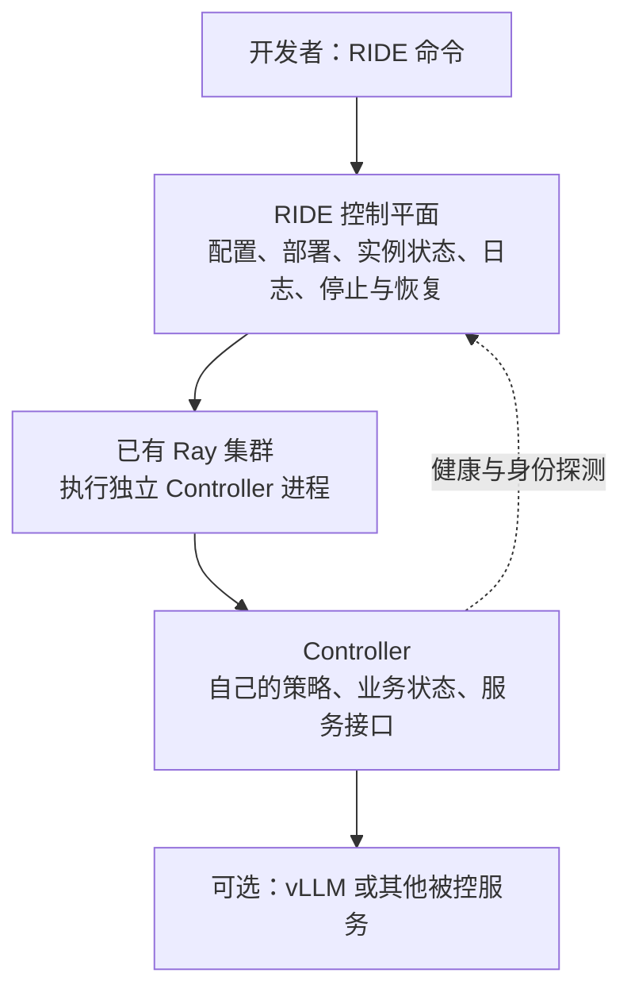

# RIDE Controller 开发规范

本规范面向开发新 Controller 的同学。最终目标：安装一个独立 Controller 包，用
`ride start controller <类型>` 将它部署到已有 Ray 集群，再统一查询状态、日志、停止和恢复。
不要求使用 YAML，不要求实现 Web UI，也不要求 Controller 自行管理 Ray。

## 1. 系统分层：谁负责什么



| 组件 | 责任 |
|---|---|
| RIDE | 发现 Controller 类型、提交 Ray Job、记录实例和 Job ID、查询状态与日志、停止与恢复 |
| Controller | 策略实现、业务状态、业务服务接口、实际健康与身份信息 |
| Ray | 进程执行、资源调度和 Job 日志 |
| Coder | 云端工作区和访问入口；不是 Controller 策略的一部分 |

Controller 是独立进程，不一定在模型请求路径上。Request Throttling 转发请求；
本 Demo 只演示部署与观测，不转发模型请求。RIDE 管理 API 不承载模型请求。

## 2. 一个 Controller 包需要提供什么

建议目录：

```text
pyproject.toml
src/your_controller/
  __init__.py
  __main__.py       # 独立进程入口与业务逻辑
  adapter.py        # RIDE 配置、命令与观测适配
scripts/acceptance.py
README.md
```

进程入口显式接收配置；不要在 import 时启动服务。日志输出到标准输出或标准错误。
依赖版本和上游代码来源写在包配置与文档中。Controller 不创建、重启或停止 Ray 集群。

通过 Python entry point 注册类型：

```toml
[project.entry-points."ride.controllers"]
demo = "ride_controller_demo.adapter:Adapter"
```

RIDE 与 Ray 执行环境均需安装这个包。安装更新后重启 RIDE 管理进程，避免继续使用旧实现。
类型名称表示实现，例如 demo；实例名称表示一次部署，例如 demo-main。
重复注册同名类型会被拒绝；内置 request-throttling 保留兼容实现，不应尝试覆盖。

适配器当前必须提供以下方法：

| 方法 | 输入与输出 | 要求 |
|---|---|---|
| `command(spec)` | 配置字典 → 命令字符串 | 校验必要配置，使用 `shlex.join` 构造明确入口 |
| `probe(spec)` | 配置字典 → 观测字典 | 返回布尔 `controller_ready`，可附 health、identity、status |

RIDE 只有在 Ray Job RUNNING 且 `controller_ready is True` 时将该实例标为 Ready。
探测异常显示为 probe_error，不当作 Ready。具体 HTTP 路径由 Controller 的适配器定义。
本 Demo 使用 `/health`、`/identity`、`/status`；其他 Controller 可以采用自己的接口。
不要伪造 Request Throttling 专用的 programs 或 scheduling_enabled 字段。

## 3. 如何部署与管理

先安装 RIDE 和 Controller 包。Controller 依赖必须在实际执行节点可用，
也可以通过 Ray runtime_env 提供。管理进程运行在自己的工作区：

```sh
ride start --ray-address http://RAY_HEAD:8265 \
  --workspace YOUR_WORKSPACE --state-file /persistent/path/ride-state.json
```

另一个工作区终端部署 Controller：

```sh
ride start controller demo --name demo-main \
  --endpoint http://CONTROLLER_HOST:9012 --port 9012 \
  --num-cpus 0.1 --num-gpus 0

ride get controller
ride describe controller demo-main
ride logs controller demo-main
ride stop controller demo-main
ride start controller demo-main
```

管理进程默认在工作区内监听 127.0.0.1:19100；跨进程管理用 `--address` 指定 RIDE 地址。
RIDE 不会自动启动已有 Ray，也不会自动分配服务地址或端口。
endpoint 必须与实际执行节点及监听端口匹配；多节点使用 `--resources` 约束放置。
不同节点之间不能用 localhost 互相访问。GPU/NPU 资源名称以实际 Ray 配置为准。
新增类型的额外配置可以通过 JSON `--config` 提供；当前没有自动生成的专用 CLI 参数。

同名同配置的运行实例重复启动不会重复提交；配置冲突会被拒绝。
恢复使用保存的配置，生成新的 Job。停止仅针对本实例的 owned Job，不停止其他服务。
停止可能打断在途请求；当前不承诺 graceful drain。

## 4. 交付与验收标准

先用隔离 CPU 云端环境证明平台流程，再按 Controller 目标验证策略与性能。

| 层次 | 最低验收要求 |
|---|---|
| 包与配置 | 独立安装、入口可启动、必要参数校验、依赖明确 |
| 部署 | RIDE 发现注册类型，提交真实 Ray Job，身份匹配，RUNNING 与 Ready |
| 生命周期 | 日志可查、重复启动 Job ID 不变、停止到终态、恢复新 Job 且 Ready |
| 隔离与恢复 | 不操作他人 Job；管理进程重启后的实例恢复需单独验证 |
| 策略 | 类型专属正确性、失败路径、开关和业务隔离用例 |
| 性能 | 同输入同硬件同配置基线对照，保留错误数和原始结果 |

Demo 的脚本运行在已有 RIDE/Ray 上，会创建、停止并恢复 demo-main：

```sh
python scripts/acceptance.py --endpoint http://CONTROLLER_HOST:9012 \
  --address http://127.0.0.1:19100 --output demo-acceptance.json
```

只能在隔离环境运行，不得操作同名生产实例。结束后先保存证据，再停止 demo-main。
脚本不启动或停止 Ray 集群。2026-10-10 的 9450 CPU 验收已通过部署、身份、Ready、
日志、重复启动、停止和恢复，见 [结果](results/acceptance.json) 与 [原始日志](results/cloud.log)。
该次 Demo 验收没有验证管理进程重启、Web UI、模型推理或策略性能；这些不能称为 PASS。

RIDE 目前没有通用策略 SDK、插件安全隔离、版本协商、自动服务发现或高可用。
适配器属于工作区可信代码。RIDE listener 应限制在工作区内，云端访问使用 owner-only 入口。

实现参考：[适配器](src/ride_controller_demo/adapter.py)、[进程入口](src/ride_controller_demo/__main__.py)。
框架接入指南：[RIDE Controller Development](https://github.com/vLLM-HUST/ride/blob/main/docs/CONTROLLER_DEVELOPMENT.md)。
总体设计：[RIDE 控制面设计文档（飞书）](https://ocnkis1vvvv6.feishu.cn/docx/CrCpd4KP8oM89pxtieyc0VnnnEf)。
本仓库的开发规范以代码与已执行验收为准；飞书中的历史规划不代表全部已实现。
